# <center>
<div style="
    background: #f0f333ff;
    border-left: 5px solid #ecd242ff;
    padding: 15px 25px;
    margin: 20px 0;
    box-shadow: 0 2px 8px rgba(0,0,0,0.08);
">
    <h1 style="
        text-align: center;
        color: #2e3a59;
        font-family: 'Segoe UI', sans-serif;
        margin: 0;
        font-weight: 600;
    ">
    Brief Make
    </h1>
</div>

####
<div style="
    background: #eebbefff;
    border-left: 5px solid #d619efff;
    padding: 15px 25px;
    margin: 20px 0;
    box-shadow: 0 2px 8px rgba(0,0,0,0.08);
">
    <h3 style="
        color: #2e3a59;
        font-family: 'Segoe UI', sans-serif;
        margin: 0;
        font-weight: 400;
    ">
    Sources
    </h3>
</div>

[Make](https://apps.make.com/http)<br>
[France travail](https://francetravail.io/)<br>
[Discord Webhooks](https://support.discord.com/hc/en-us/articles/228383668-Intro-to-Webhooks)<br>
[API OpenWebNinja](https://app.openwebninja.com/)

##
<div style="
    background: #40f0aa;
    border-left: 5px solid #0c7230ff;
    padding: 15px 25px;
    margin: 20px 0;
    box-shadow: 0 2px 8px rgba(0,0,0,0.08);
">
    <h2 style="
        color: #2e3a59;
        font-family: 'Segoe UI', sans-serif;
        margin: 0;
        font-weight: 500;
    ">
    Etape 0 : Apprendre Make
    </h2>
</div>

###
<div style="
    background: #9feaf2ff;
    border-left: 5px solid #1d28c1ff;
    padding: 15px 25px;
    margin: 20px 0;
    box-shadow: 0 2px 8px rgba(0,0,0,0.08);
">
    <h3 style="
        color: #2e3a59;
        font-family: 'Segoe UI', sans-serif;
        margin: 0;
        font-weight: 500;
    ">
    Tuto 1 : Connecter Google Sheets à Make
    </h3>
</div>

Après s'être connecté à Make on connecte Google Sheets à Make

<br>


On vérifie la connexion :


###
<div style="
    background: #9feaf2ff;
    border-left: 5px solid #1d28c1ff;
    padding: 15px 25px;
    margin: 20px 0;
    box-shadow: 0 2px 8px rgba(0,0,0,0.08);
">
    <h3 style="
        color: #2e3a59;
        font-family: 'Segoe UI', sans-serif;
        margin: 0;
        font-weight: 500;
    ">
    Tuto 1 : Construire la veille RSS
    </h3>
</div>

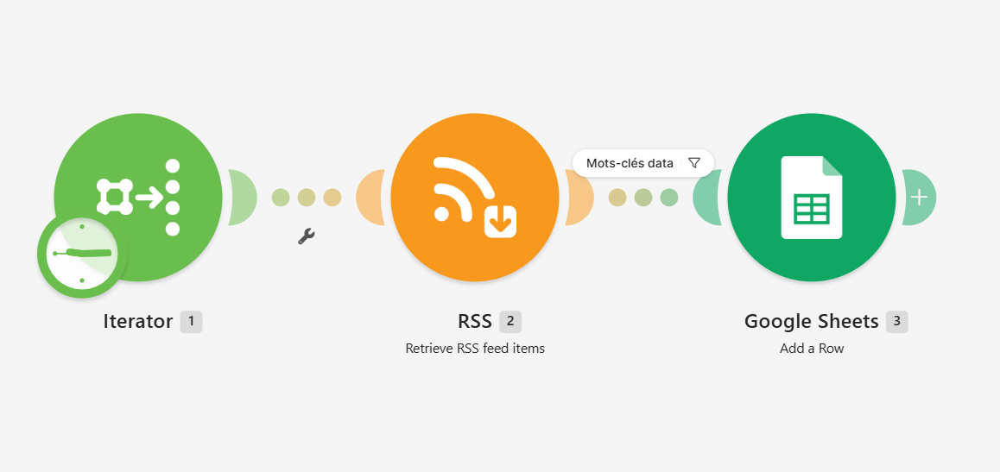

####
<div style="
    background: #eebbefff;
    border-left: 5px solid #d619efff;
    padding: 15px 25px;
    margin: 20px 0;
    box-shadow: 0 2px 8px rgba(0,0,0,0.08);
">
    <h3 style="
        color: #2e3a59;
        font-family: 'Segoe UI', sans-serif;
        margin: 0;
        font-weight: 400;
    ">
    Subsub section
    </h3>
</div>

##
<div style="
    background: #40f0aa;
    border-left: 5px solid #0c7230ff;
    padding: 15px 25px;
    margin: 20px 0;
    box-shadow: 0 2px 8px rgba(0,0,0,0.08);
">
    <h2 style="
        color: #2e3a59;
        font-family: 'Segoe UI', sans-serif;
        margin: 0;
        font-weight: 500;
    ">
    Recherche d'emploi
    </h2>
</div>

###
<div style="
    background: #9feaf2ff;
    border-left: 5px solid #1d28c1ff;
    padding: 15px 25px;
    margin: 20px 0;
    box-shadow: 0 2px 8px rgba(0,0,0,0.08);
">
    <h3 style="
        color: #2e3a59;
        font-family: 'Segoe UI', sans-serif;
        margin: 0;
        font-weight: 500;
    ">
    Etape 1 : API JSearch
    </h3>
</div>

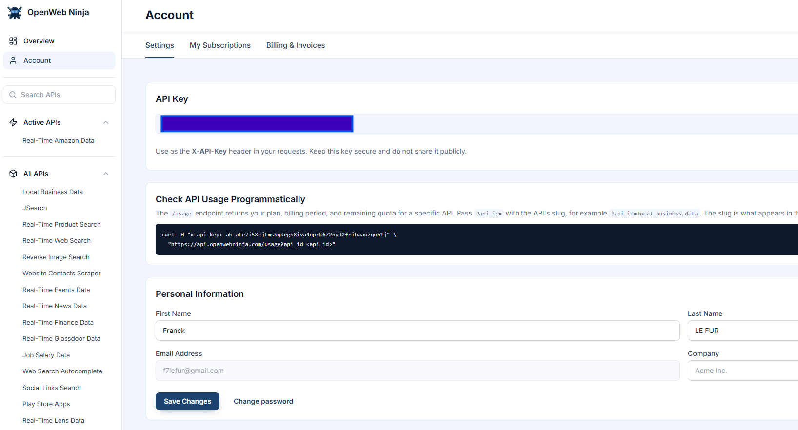

```py
import requests

headers = {
  "X-API-Key": "ak_******"
}

response = requests.request(
    'GET',
    'https://api.openwebninja.com/realtime-web-search/search',
    params={"q":"how to build a website"},
    headers=headers
)

print(response.status_code)
print(response.headers['content-type'])
print(response.text)
print(response.json())
```

###
<div style="
    background: #9feaf2ff;
    border-left: 5px solid #1d28c1ff;
    padding: 15px 25px;
    margin: 20px 0;
    box-shadow: 0 2px 8px rgba(0,0,0,0.08);
">
    <h3 style="
        color: #2e3a59;
        font-family: 'Segoe UI', sans-serif;
        margin: 0;
        font-weight: 500;
    ">
    Etape 2 : Préparer Discord
    </h3>
</div>

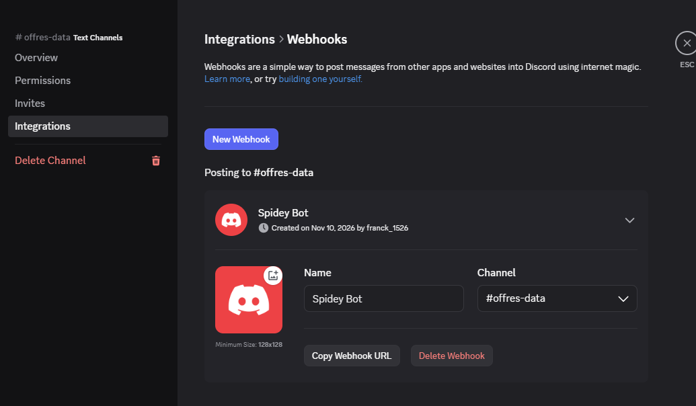

**Question : un webhook est une « adresse postale » du salon. Pourquoi faut-il la garder secrète ?**<br>

Il faut garder un webhook secret car toute personne qui possède son adresse peut l’utiliser pour envoyer des messages dans le salon, même sans être membre du serveur. Il faut donc la protéger pour que personne n'envoie des messages à notre place.

###
<div style="
    background: #9feaf2ff;
    border-left: 5px solid #1d28c1ff;
    padding: 15px 25px;
    margin: 20px 0;
    box-shadow: 0 2px 8px rgba(0,0,0,0.08);
">
    <h3 style="
        color: #2e3a59;
        font-family: 'Segoe UI', sans-serif;
        margin: 0;
        font-weight: 500;
    ">
    Etape 3 : Concevoir le Sheet de suivi
    </h3>
</div>

<br>

**Questions : à quoi sert la colonne « site d'origine » ? Quelles colonnes Make doit-il remplir, et lesquelles sont pour vous ?**<br>

La colonne "site d'origine" sert à indiquer le site web depuis lequel l'information a été récupérée (source fiable).<br>
- Colonnes pour Make : la date de publication, l'intitulé, l'entreprise, le lieu, le type de contrat, le site d'origine de l'offre et le lien pour postuler.<br>
- Colonnes pour vous : un statut, une date de candidature et des notes.

###
<div style="
    background: #9feaf2ff;
    border-left: 5px solid #1d28c1ff;
    padding: 15px 25px;
    margin: 20px 0;
    box-shadow: 0 2px 8px rgba(0,0,0,0.08);
">
    <h3 style="
        color: #2e3a59;
        font-family: 'Segoe UI', sans-serif;
        margin: 0;
        font-weight: 500;
    ">
    Etape 4 : Module HTTP
    </h3>
</div>

On crée un module "HTTP > Make a Request" dans lequel on renseigne l'URL de la requête API ainsi que notre clé secrète d'API et des champs de requêtes.

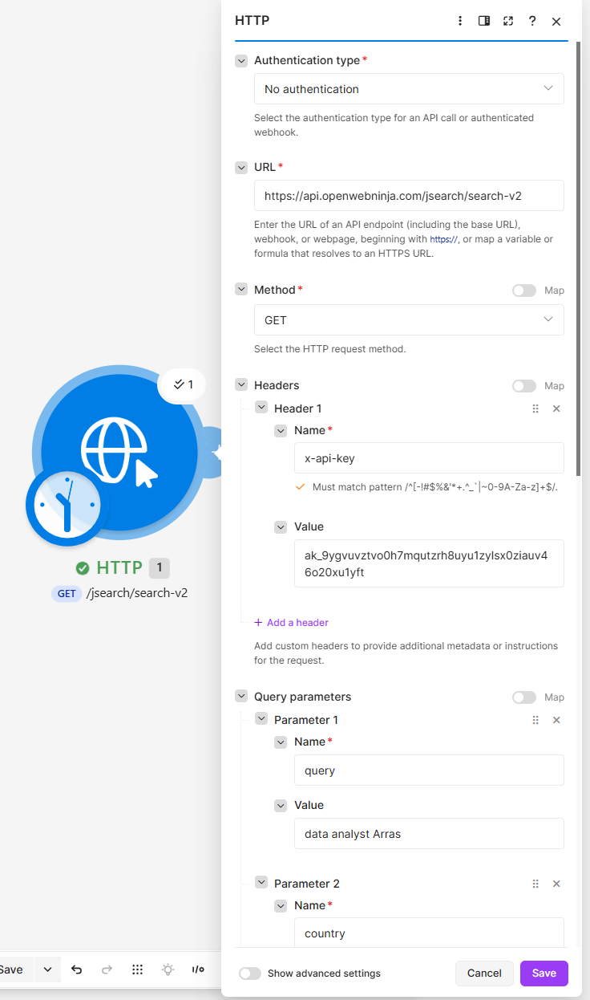<br>

ON lance le module "Google Sheets", on s'assure que le résultat n'est pas vide dans `jobs[]`
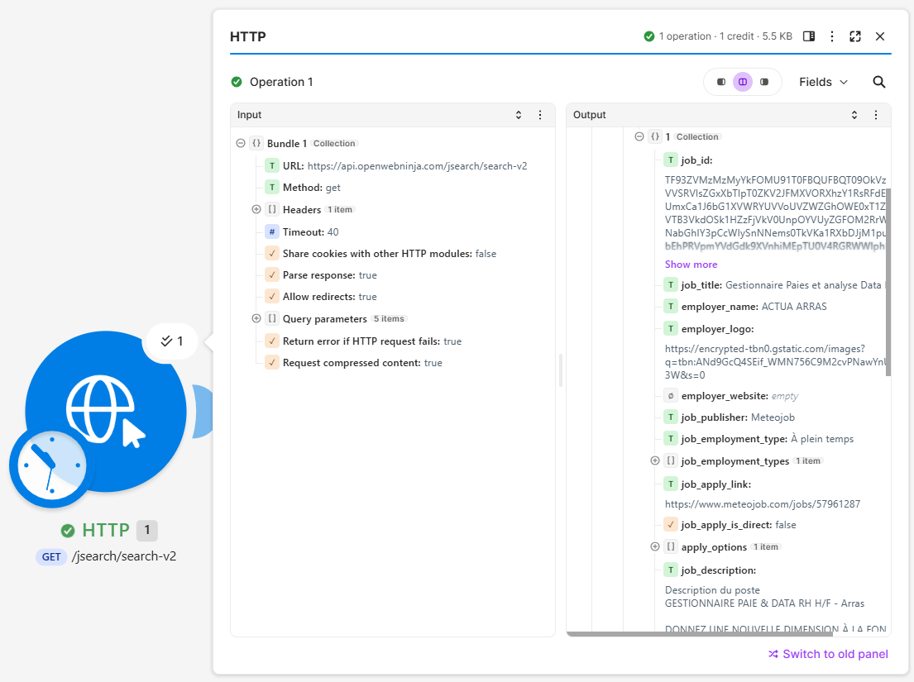

###
<div style="
    background: #9feaf2ff;
    border-left: 5px solid #1d28c1ff;
    padding: 15px 25px;
    margin: 20px 0;
    box-shadow: 0 2px 8px rgba(0,0,0,0.08);
">
    <h3 style="
        color: #2e3a59;
        font-family: 'Segoe UI', sans-serif;
        margin: 0;
        font-weight: 500;
    ">
    Etape 5 : Iterator + Google Sheets
    </h3>
</div>

On ajoute un module "Iterator" qui doit boucler sur le résultat `Data/data/jobs[]` du module "HTTP".<br>
On choisit les champs à remplir dans le Google Sheets, on peut utiliser des fonctions proposées par MAKE (pour le formatage du texte, des dates ou d'autres opérations ...)

 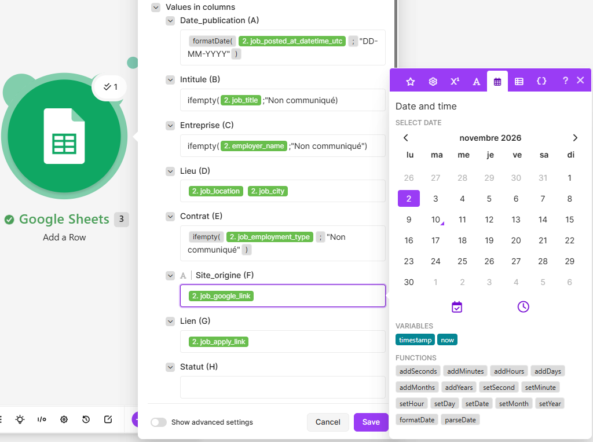

 **Questions guidantes : pourquoi certaines offres n'ont-elles pas de nom d'entreprise ou de lieu ? Que se passerait-il dans votre Sheet sans ifempty ?**<br>

Certaines offres d'emploi n'ont pas de nom d'entreprise ou de lieu ou ne sont pas disponibles dans les données récupérées par l'API.<br>
La fonction ifempty permet de remplacer une valeur vide par une valeur par défaut dans le Google Sheets.

###
<div style="
    background: #9feaf2ff;
    border-left: 5px solid #1d28c1ff;
    padding: 15px 25px;
    margin: 20px 0;
    box-shadow: 0 2px 8px rgba(0,0,0,0.08);
">
    <h3 style="
        color: #2e3a59;
        font-family: 'Segoe UI', sans-serif;
        margin: 0;
        font-weight: 500;
    ">
    Etape 6 : Alerte Discord
    </h3>
</div>

On ajoute un module "HTTP" où l'on renseugne l'adresse (wbehook") de notre serveur/salon discord.

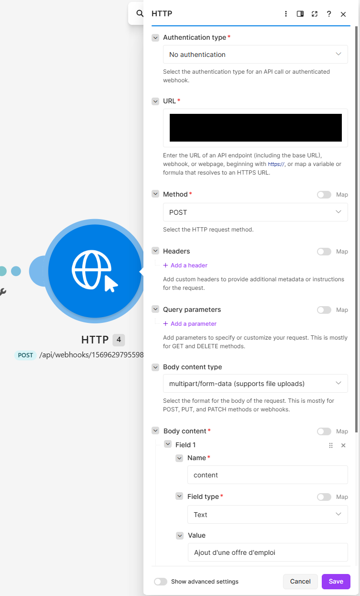<br>
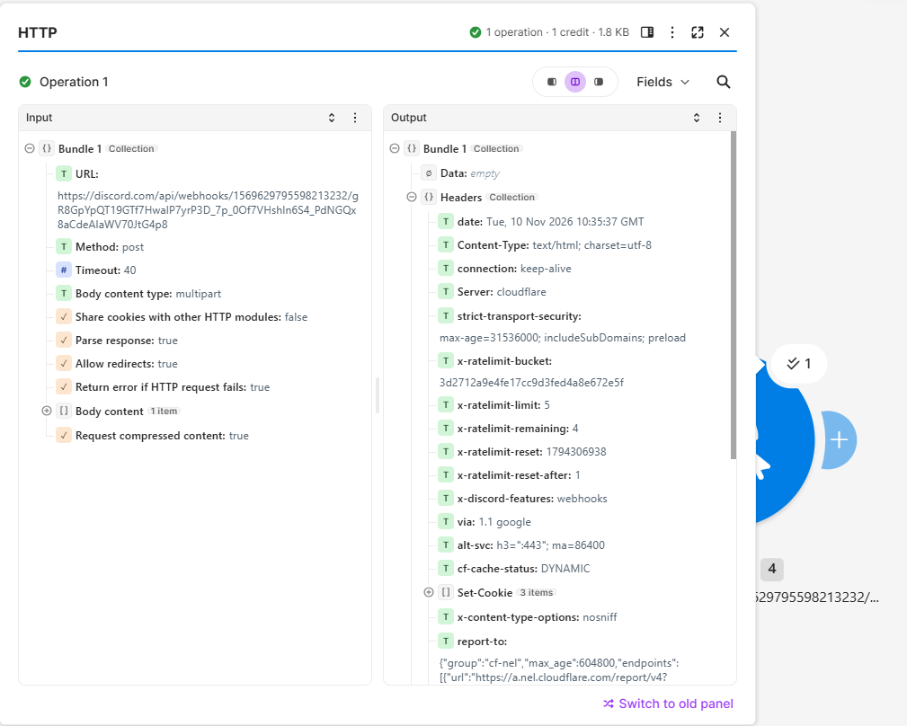

###
<div style="
    background: #9feaf2ff;
    border-left: 5px solid #1d28c1ff;
    padding: 15px 25px;
    margin: 20px 0;
    box-shadow: 0 2px 8px rgba(0,0,0,0.08);
">
    <h3 style="
        color: #2e3a59;
        font-family: 'Segoe UI', sans-serif;
        margin: 0;
        font-weight: 500;
    ">
    Etape 7 : Tester, Planifier, Compter
    </h3>
</div>

On lance le scénario pour s'assurer que tout fonctionne (le Google Sheets est rempli, et on reçoit les notifications dans Discord)

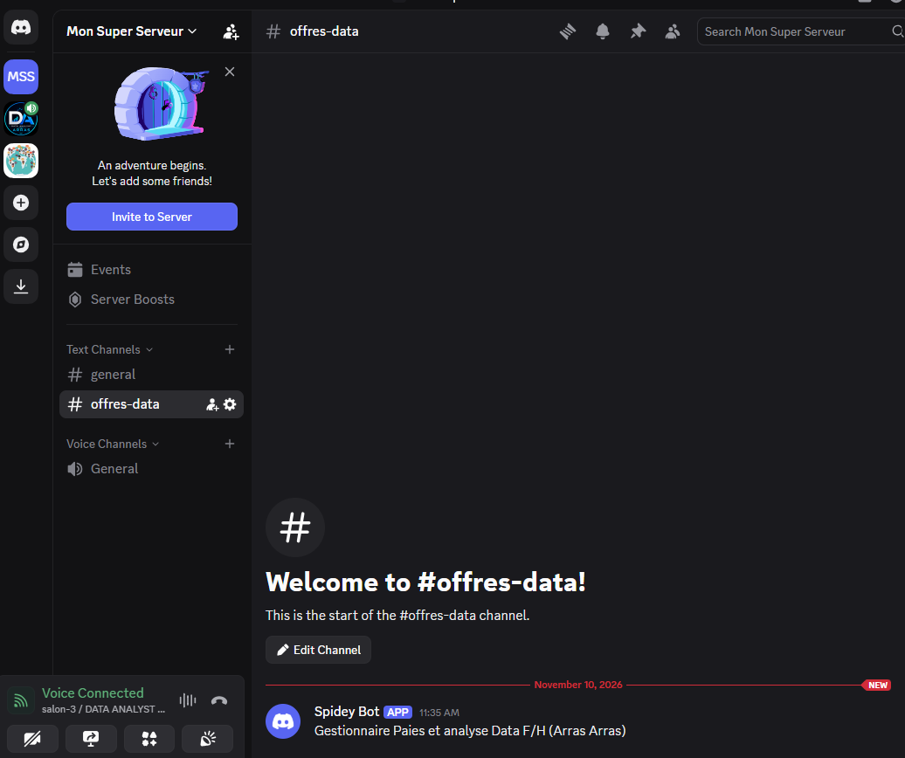

On planifie le scénario et on l'active.

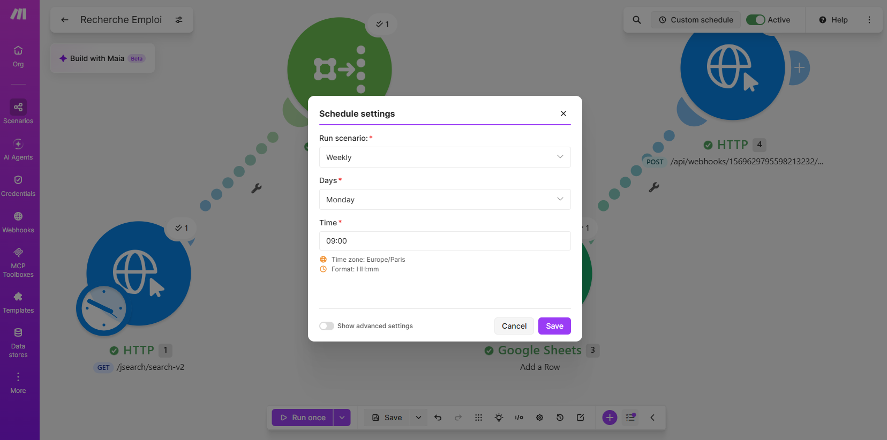

####
<div style="
    background: #eebbefff;
    border-left: 5px solid #d619efff;
    padding: 15px 25px;
    margin: 20px 0;
    box-shadow: 0 2px 8px rgba(0,0,0,0.08);
">
    <h3 style="
        color: #2e3a59;
        font-family: 'Segoe UI', sans-serif;
        margin: 0;
        font-weight: 400;
    ">
    Usage des crédits MAKE
    </h3>
</div>

On regarde combien de crédits consomme notre scénario :

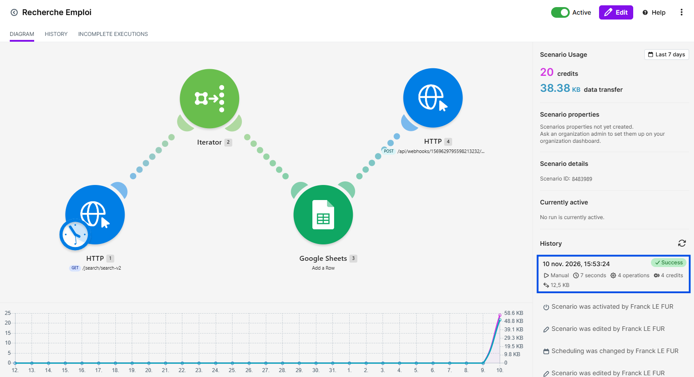

Il consomme 4 crédits.

On peut suivre notre consommation dans l'onglet "Org > Dashboard"

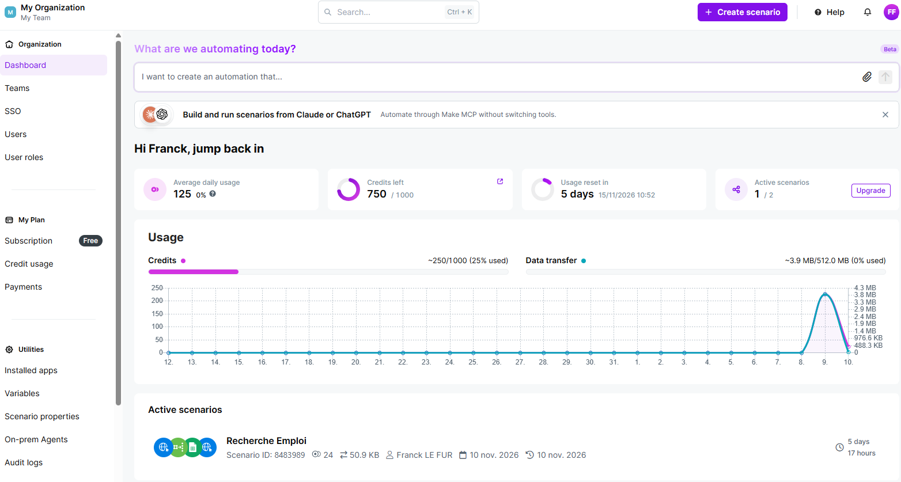

Difficile d'estimer la consommation sur 1 mois car si le nombre de modules est fixe (au nombre de 4) cela dépend aussi de la quantité de données traitées.<br>

Mais si on estime à 10 le nombre d'annonces trouvées par semaine, cela fait 22 crédits soit 4x22 = 88 crédits par mois environ :
- module HTTP Web Search : 1 crédit
- module Iterator : 10 crédits (1 par résultat)
- module Google Sheets : 10 crédits (1 par résultat)
- module HTTP Discord :  1 crédit
- total : 22 crédits

**Questions guidantes : pourquoi une exécution par semaine avec date_posted = week évite-t-elle la plupart des doublons ?<br>
Combien de recherches différentes (villes, contrats) pouvez-vous lancer chaque semaine avec 200 requêtes JSearch et 1 000 crédits Make par mois ?**
